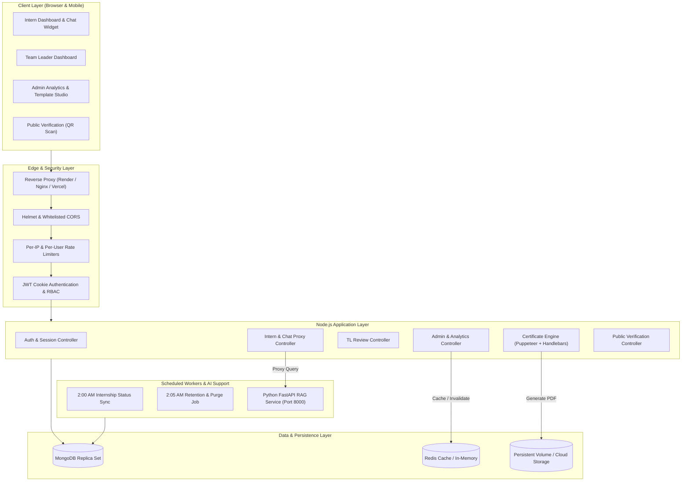
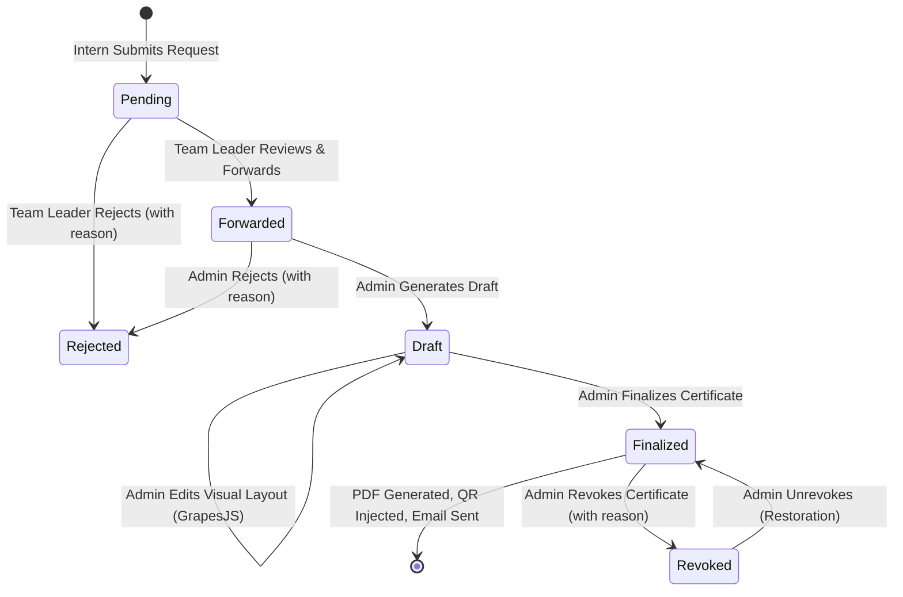
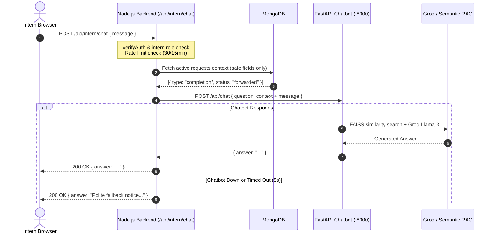

# System Architecture Specification

**Last Updated:** 2026-11-04  
**Project:** UPTOSKILL Intern Portal  
**Document Version:** 4.0.0 (Production Release)

---

## 1. System Overview

The **UPTOSKILL Intern Portal** is a production-grade, enterprise web application built for managing the end-to-end internship lifecycle—from onboarding and milestone tracking to certificate issuance, cryptographic verification, administrative analytics, and automated support.

The system is designed with a **stateless Node.js/Express backend**, a **high-performance React/Vite SPA frontend**, **MongoDB** for persistence, and an integrated **FastAPI AI Support Chatbot service**.

---

## 2. Authentication & Unified User Architecture

The platform uses a unified `users` collection in MongoDB for all three distinct roles, preventing data duplication and simplifying authorization:
- **`admin`**: Full governance, certificate review/editing/finalization, user CRUD, audit logs, template designer, retention policies, and analytics exports.
- **`teamleader`**: Manages assigned domain cohorts, inspects assigned intern progress, forwards or rejects certificate requests with feedback.
- **`intern`**: Initial access via unique `internCode`, mandatory password setup, profile phone updates, certificate requests, status tracking, and AI chatbot assistance.

### Authentication Flow
1. **Credentials Validation**: Validates email/password (or first-time intern code) against bcrypt password hashes (cost factor 10).
2. **Session Cookie**: Issues an `httpOnly`, `secure` (in production), `sameSite: none` (cross-domain) or `lax` JWT cookie valid for 7 days.
3. **Role-Based Access Control (RBAC)**: Verified by `verifyAuth` and `checkRole(['admin', ...])` middleware. Non-admin routes reject unauthorized actors with `403 Forbidden`.

---

## 3. Certificate Lifecycle State Machine

Certificate issuance enforces a strict 4-step progressive approval flow:

1. **Submission**: Intern submits request for one of 8 standardized certificate types (`completion_certificate`, `offer_letter`, `bonafide`, `ojt_certificate`, `experience_letter`, etc.). Duplicate active pending requests are blocked (HTTP 409).
2. **TL Review**: Assigned Team Leader inspects completion criteria. Can **Forward** to Admin or **Reject** with mandatory feedback.
3. **Draft & Customization**: Admin opens the request, previews the Handlebars template with trusted MongoDB tokens, and can visually adjust text, fonts, margins, and signatures using the embedded visual editor.
4. **Finalization & PDF Generation**: 
   - A cryptographically unique 12-character hex `verifyId` is generated.
   - An interactive, scannable QR code linking to `/verify/:verifyId` is generated using `qrcode`.
   - Puppeteer renders the HTML layout into vector PDF in a headless Chromium container with `--no-sandbox` and `--disable-dev-shm-usage`.
   - Finalized PDF is saved to persistent storage, and an automated email containing the certificate link is dispatched to the intern via Brevo SMTP.
5. **Revocation**: If fraudulent activity occurs, Admin revokes the certificate with an audit log reason. The public verification page immediately displays a red `revoked` state.

---

## 4. Scheduled Jobs Architecture

To prevent duplicate runs across horizontal replicas, daily jobs execute at fixed off-peak hours with Asia/Kolkata timezone:
- **`0 2 * * *` (2:00 AM IST) - Internship Status Job**: Automatically updates intern status from `upcoming` to `ongoing` when `startDate <= today`, and from `ongoing` to `completed` when `endDate < today`.
- **`5 2 * * *` (2:05 AM IST) - Retention & Privacy Job**: 
  - 7 days prior to archival: Sends notification & email warning to completed interns.
  - Grace Period expiry (default 30 days): Sets `isArchived = true`, preventing intern dashboard access.
  - Purge Period expiry (default 90 days): Clears personal identifiable information (PII) according to privacy compliance while retaining anonymized completion statistics.

---

## 5. Support Chatbot Architecture (Task M)

- **Security Isolation**: The browser never communicates with the Python chatbot directly. The chatbot API keys and host ports are invisible to the public internet.
- **Context Awareness**: Intern-specific non-sensitive request summaries are appended dynamically so the bot can answer questions like *"What is the status of my certificate?"*.
- **Resilience**: A strict 8-second HTTP timeout ensures the Node.js event loop is never hung. Unreachable or slow AI services return a graceful support message.

