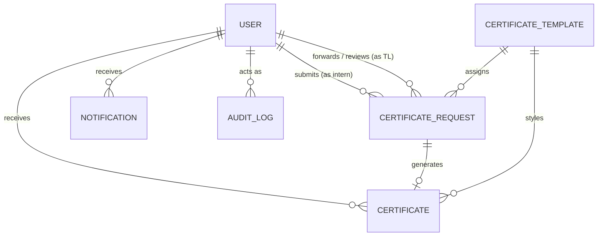

# Data Model & Schema Specification

**Last Updated:** 2026-11-04  
**Database:** MongoDB  
**ORM / Driver:** Mongoose v9.x  

---

## 1. Entity Relationship Diagram

---

## 2. Collections Reference

### 2.1 `users`
Central user collection governing all three roles (`admin`, `teamleader`, `intern`).

| Field Name | Type | Constraints / Defaults | Description |
| :--- | :--- | :--- | :--- |
| `_id` | ObjectId | Primary Key | MongoDB Unique Identifier |
| `fullName` | String | Required | Full legal name of user |
| `email` | String | Required, Unique, Lowercase | Primary contact and login email |
| `password` | String | Bcrypt hash | Password hash (cost factor 10) |
| `role` | String | Enum: `admin`, `teamleader`, `intern` | RBAC role |
| `internCode` | String | Unique, Sparse | Unique code issued upon enrollment (`UTS-YYYY-XXXX`) |
| `domain` | String | Optional | Department or technical domain (e.g., Web Dev, AI/ML) |
| `mobileNo` | String | Optional (10-15 digits) | Contact phone number (intern editable) |
| `startDate` | Date | Optional | Internship commencement date |
| `endDate` | Date | Optional | Scheduled internship completion date |
| `isArchived` | Boolean | Default: `false` | True if account is archived past grace period |
| `archivedAt` | Date | Default: `null` | Timestamp of account archival |
| `archiveWarningSentAt` | Date | Default: `null` | Timestamp warning email was dispatched |
| `archiveRestoredAt` | Date | Default: `null` | Timestamp admin unarchived the intern |
| `personalDataPurged` | Boolean | Default: `false` | True when PII is redacted past purge retention |
| `passwordSetAt` | Date | Default: `null` | Date intern established permanent password |
| `internshipDetails` | Object | Subdocument | Mentorship and team leader assignments: |
| &nbsp;&nbsp;`teamLeaderId` | ObjectId | Ref: `users` | Assigned Team Leader ID |
| &nbsp;&nbsp;`teamleaderEmail` | String | Lowercase | Cached TL email address |
| &nbsp;&nbsp;`status` | String | Enum: `upcoming`, `ongoing`, `completed`, `cancelled` | Live lifecycle state |
| &nbsp;&nbsp;`collegeName` | String | Optional | Educational institution |

**Indexes:**
- `{ email: 1 }` (unique)
- `{ internCode: 1 }` (unique, sparse)
- `{ role: 1, domain: 1, 'internshipDetails.teamLeaderId': 1, createdAt: 1 }`
- `{ role: 1, isArchived: 1, archivedAt: 1 }`

---

### 2.2 `certificate_requests`
Tracks intern requests for certificate issuance from initial submission to final completion.

| Field Name | Type | Constraints | Description |
| :--- | :--- | :--- | :--- |
| `_id` | ObjectId | Primary Key | MongoDB identifier |
| `requestNumber` | String | Required, Unique | Unique request tracking code (`REQ-YYYY-XXXXX`) |
| `userId` | ObjectId | Required, Ref: `users` | Intern who created the request |
| `internCode` | String | Required | Cached code of the intern |
| `certificateType` | String | Required | Enum or slug (`completion_certificate`, `offer_letter`, etc.) |
| `templateId` | ObjectId | Optional, Ref: `certificate_templates` | Assigned template |
| `status` | String | Enum: `pending`, `approved`, `rejected`, `processing`, `completed` | Workflow status |
| `reason` | String | Optional | Request justification from intern |
| `rejectionReason` | String | Optional | Reason provided if TL or Admin rejected request |
| `requestedAt` | Date | Default: `Date.now` | Submission timestamp |
| `forwardedBy` | ObjectId | Optional, Ref: `users` | TL who forwarded request to Admin |
| `forwardedAt` | Date | Optional | Timestamp of TL forward |
| `reviewedBy` | ObjectId | Optional, Ref: `users` | Admin who approved or rejected |
| `reviewedAt` | Date | Optional | Timestamp of Admin review |
| `completedAt` | Date | Optional | Timestamp certificate was finalized |
| `certificateId` | ObjectId | Optional, Ref: `certificates` | Finalized certificate document link |

**Indexes:**
- `{ requestNumber: 1 }` (unique)
- `{ userId: 1, requestedAt: -1, status: 1 }`
- `{ status: 1, requestedAt: -1, forwardedAt: -1, reviewedAt: -1 }`
- `{ certificateType: 1, status: 1 }`

---

### 2.3 `certificates`
Persistent credential records containing rendered templates, verify IDs, and revocation state.

| Field Name | Type | Description |
| :--- | :--- | :--- |
| `_id` | ObjectId | Primary Key |
| `certificateNumber` | String | Human-readable sequential code (`UTS-YYYY-XXXXXX`) |
| `verifyId` | String | Cryptographic 12-character hex ID used in QR codes & `/verify/:verifyId` |
| `userId` | ObjectId | Ref: `users` (Intern recipient) |
| `requestId` | ObjectId | Ref: `certificate_requests` |
| `certificateTitle`| String | Official display title (e.g. "Internship Completion Certificate") |
| `recipientName` | String | Recipient full name rendered on the document |
| `domain` | String | Technical domain name |
| `status` | String | Enum: `draft`, `finalized`, `revoked` |
| `htmlContent` | String | Raw compiled HTML content rendered by Puppeteer |
| `pdfPath` | String | Server path or storage URI (`uploads/certificates/...`) |
| `isRevoked` | Boolean | True if credential has been invalidated by administration |
| `revokedAt` | Date | Timestamp of revocation |
| `revokedBy` | ObjectId | Ref: `users` (Admin who revoked) |
| `revokedReason` | String | Justification recorded for revocation |
| `issuedAt` | Date | Date and time certificate was formally issued |

---

### 2.4 `audit_logs`
Immutable, append-only security log recording sensitive system and administrative events.

| Field Name | Type | Description |
| :--- | :--- | :--- |
| `_id` | ObjectId | Primary Key |
| `actor` | String | Role (`admin`, `teamleader`, `intern`, `system`) |
| `actorId` | ObjectId | Ref: `users` (`null` for system actions) |
| `action` | String | Action verb (e.g., `LOGIN`, `CERTIFICATE_FINALIZED`, `CERTIFICATE_REVOKED`) |
| `targetType` | String | Entity affected (`certificate`, `user`, `request`, `template`) |
| `targetId` | ObjectId | Targeted entity document ID |
| `ip` | String | Client IP address recorded behind reverse proxy |
| `userAgent` | String | Client browser / device user agent |
| `meta` | Object | Sanitized metadata (passwords, tokens, secrets stripped) |
| `createdAt` | Date | Timestamp (Indexed) |

---

### 2.5 `notifications`
User alert and messaging records powering the dropdown and badge counters.

| Field Name | Type | Description |
| :--- | :--- | :--- |
| `_id` | ObjectId | Primary Key |
| `userId` | ObjectId | Target recipient |
| `type` | String | Event classification (`REQUEST_FORWARDED`, `CERTIFICATE_READY`, etc.) |
| `title` | String | Notification subject |
| `message` | String | Notification body text |
| `isRead` | Boolean | Read state (default: `false`) |
| `readAt` | Date | Timestamp marked as read |
| `createdAt` | Date | Delivery timestamp |

