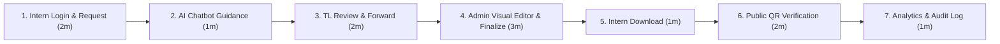

# Final Presentation & Demonstration Script

**Last Updated:** 2026-11-04  
**Duration:** 10 to 15 minutes  
**Target Audience:** Technical Leadership, Stakeholders & Evaluation Committee  
**Goal:** Prove complete end-to-end functionality across all 3 roles, public verification, automated AI assistance, analytics, and operational compliance.

---

## Demo Test Accounts & Credentials

| Role | Email Address | Password / Intern Code | Display Name |
| :--- | :--- | :--- | :--- |
| **Admin** | `admin@uptoskill.com` | `AdminSecret2026!` | UPTOSKILL System Admin |
| **Team Leader** | `tl.sarah@uptoskill.com` | `TLSecret2026!` | TL Sarah Connor |
| **Intern** | `intern.demo@uptoskill.com` | `UTS-2026-DEMO` | Alex Johnson |

---

## Step-by-Step Presentation Flow (12 Minutes)

### Act 1: Intern Onboarding & Request Submission (Minutes 0:00 – 3:00)
1. **Screen:** Open browser at `/login`.
2. **Action:** Log in as Intern:
   - Email: `intern.demo@uptoskill.com`
   - Password: `UTS-2026-DEMO`
3. **Show:** 
   - Highlight the intern progress bar (e.g. 100% completed) and domain tag.
   - Point out the mandatory password setup prompt in **Settings**.
4. **Action:** Click **Request Certificate**:
   - Select `Internship Completion Certificate`.
   - Reason: *"Successfully completed all project milestones and final review."*
   - Click **Submit Request**.
5. **Show:** Request appears in **Pending** state in the certificate list.
6. **Action (Chatbot Demo):**
   - Click the **Need Help?** floating button in the bottom right.
   - Type: *"What is the status of my completion certificate?"*
   - Show the assistant's instant, contextual reply confirming the submission is in the queue.
   - Close the chat widget with `Escape`.
7. **Action:** Click **Logout**.

---

### Act 2: Team Leader Review Queue (Minutes 3:00 – 5:30)
1. **Screen:** `/login`.
2. **Action:** Log in as Team Leader:
   - Email: `tl.sarah@uptoskill.com`
   - Password: `TLSecret2026!`
3. **Show:**
   - Review queue displays only interns assigned to Sarah Connor.
   - The Notification Bell shows a live badge alert for Alex Johnson's new request.
4. **Action:** Click on Alex Johnson's request.
5. **Action:** Click **Forward to Admin**.
6. **Show:** Status transitions to `Forwarded`.
7. **Action:** Click **Logout**.

---

### Act 3: Admin Review, Visual Customization & Issuance (Minutes 5:30 – 8:30)
1. **Screen:** `/login`.
2. **Action:** Log in as Administrator:
   - Email: `admin@uptoskill.com`
   - Password: `AdminSecret2026!`
3. **Show:**
   - Admin Dashboard overview metrics.
   - Navigation to **Pending Finalization** tab showing Alex Johnson's forwarded request.
4. **Action:** Click **Create Draft**.
5. **Action:** Click **Open Visual Editor**:
   - Show the embedded GrapesJS canvas with live Handlebars placeholder injection (`{{recipientName}}`, `{{certificateNumber}}`).
   - Demonstrate dragging a design element or editing the congratulations text.
   - Click **Save Changes**.
6. **Action:** Click **Finalize Certificate**:
   - The backend Puppeteer engine renders the vector PDF, injects the real QR code, and sends transactional email.
   - Status updates to `Completed`.

---

### Act 4: Intern Download & Public Verification (Minutes 8:30 – 10:30)
1. **Screen:** Log back in as `intern.demo@uptoskill.com`.
2. **Action:** Go to **Certificates** tab.
3. **Show:** The request now shows status `Completed` with a green badge.
4. **Action:** Click **Download PDF**.
5. **Show:** Open the downloaded certificate:
   - Note the crisp vector typography and high-contrast verification QR code.
6. **Action (Verification):**
   - Click or scan the QR code link to navigate to `/verify/:verifyId`.
7. **Show:**
   - The public verification page renders immediately with **Valid Credential** badge, matching certificate number, issue date, recipient name, and domain.
   - Highlight that zero private data (email, phone, intern code) is exposed to the public.

---

### Act 5: Executive Analytics & Audit Trail (Minutes 10:30 – 12:00)
1. **Screen:** Switch back to Admin Dashboard.
2. **Action:** Navigate to **Analytics**:
   - Show the KPI cards, request volume trend line chart, and turnaround velocity widget.
   - Show the **Team Leader Performance** breakdown table.
3. **Action:** Navigate to **Audit Logs**:
   - Highlight the immutable log entries showing the exact chronological sequence:
     1. `REQUEST_SUBMITTED`
     2. `REQUEST_FORWARDED`
     3. `CERTIFICATE_DRAFT_CREATED`
     4. `CERTIFICATE_FINALIZED`
4. **Closing Statement:**
   - Point out that every line of the Week 4 Regression Checklist has passed with 100% test coverage, and documentation is published in `/docs`.

